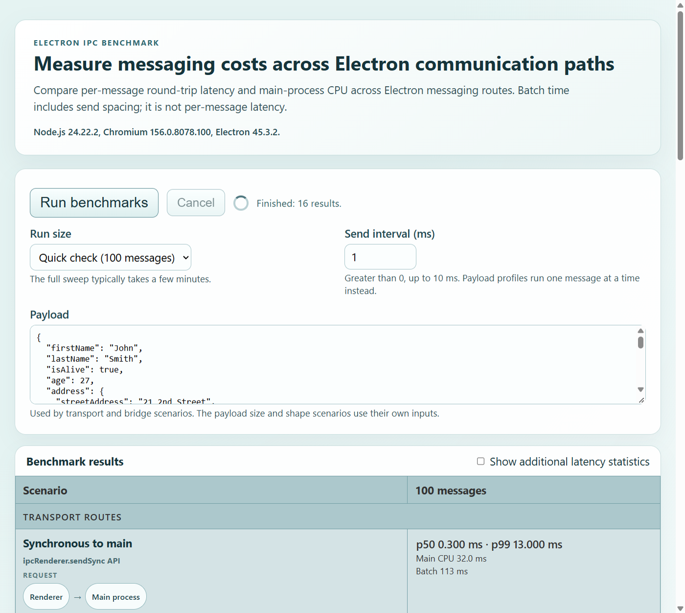
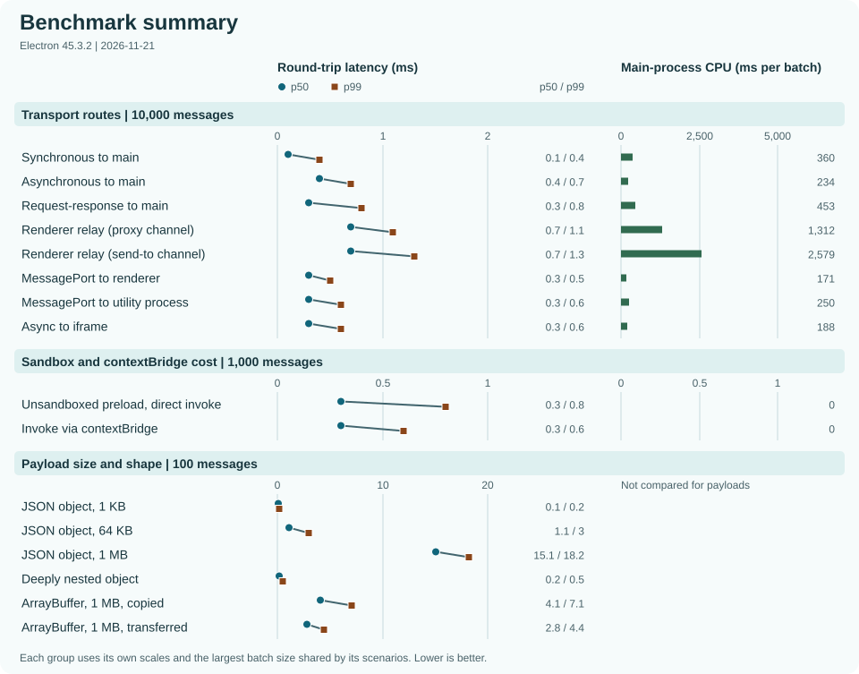

# electron-bench

[](https://github.com/ZacWalk/electron-bench/actions/workflows/ci.yml)

A desktop benchmark for Electron IPC. It compares 16 scenarios covering messaging routes, sandbox and contextBridge overhead, and payload size and shape.

**[View benchmark results](./best-practices.md#latest-data)** · [How to read the numbers](./best-practices.md#how-to-read-these-numbers)



## Run locally

Requires **Node.js 22.12 or later**, a 64-bit operating system on x64 or arm64, and macOS 13 or later on Macs.

```sh
git clone https://github.com/ZacWalk/electron-bench.git
cd electron-bench
npm ci
npm start
```

Electron downloads its platform binary on first launch if it is not cached. To download it before launching, run `npm exec --no -- install-electron`.

Choose **Quick check** for one batch per scenario, or **Full sweep** to test transport routes at 100, 1,000, and 10,000 messages. Each result shows median (p50) and p99 round-trip latency, main-process CPU where relevant, and batch elapsed time. Use **Cancel** to stop the current run without losing results already displayed.

## Benchmark summary



The app shows this same chart for your own run. The chart uses the largest shared batch size in each group; see the [full results](./best-practices.md#latest-data) for every batch size.

## Command line

| Command | What it does |
| --- | --- |
| `npm run bench:run` | Run the full sweep with hidden windows and write JSON to `bench-results/latest.json`. |
| `npm run bench:smoke` | Run all scenarios at 100 messages and write `bench-results/ci.json`. |
| `npm run bench:validate` | Validate the latest JSON file. |
| `npm run bench:refresh-docs` | Run the full sweep and refresh the chart and [detailed results](./best-practices.md#latest-data). |

For a custom run, use `npm exec --no -- electron . --bench-output=results.json --bench-counts=25,100`. Transport counts may be 1–10,000; the bridge and payload groups retain one count, capped at the largest requested count. `--bench-timeout` sets the overall timeout in milliseconds. Automation exits nonzero if any batch is incomplete or fails.

## Tests

```sh
npm test
npm run test:desktop
```

`npm test` runs syntax checks, unit tests, and the hidden Electron smoke test. `test:desktop` opens the app and exercises settings, cancellation, reruns, and result display. CI runs both on Windows, macOS, and Linux. Linux CI uses Xvfb and `--no-sandbox`; those runs verify behavior, not the cost of the Chromium sandbox.
