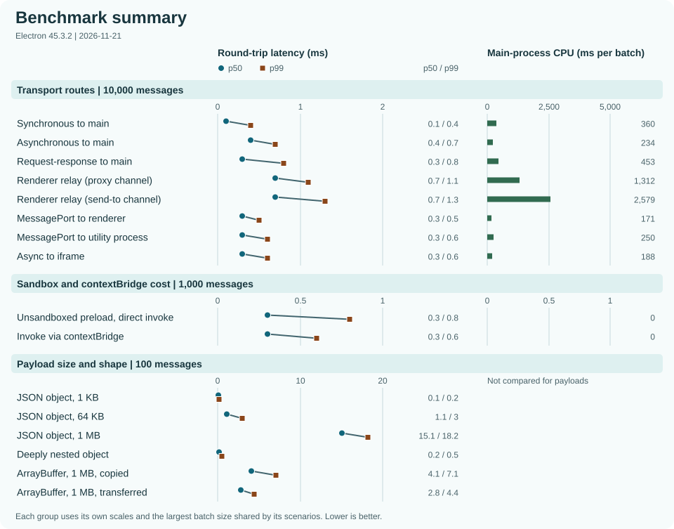

# IPC best practices

## How to read these numbers

Compare **per-message p50 and p99 latency** with **total main-process CPU**. Batch elapsed time also includes send spacing and is not a latency measurement. For direct ports, setup happens before the timed sends; the payload comparison focuses on latency.

Transport and bridge scenarios schedule sends at the configured spacing without waiting for each reply. Payload scenarios send one at a time and wait for the reply so large messages do not accumulate in queues. The two renderer-relay rows are separate application channels using the same main-process relay pattern, not different transports.

The results below are a single-machine snapshot. Route rankings and exact multiples can change with workload, Electron version, and OS timer resolution. Main-process CPU includes unrelated work the process did during the batch; a small value may round to zero.

## Keep the main process out of the hot path

* Prefer `MessagePort` or a `utilityProcess` channel for sustained traffic. Both move messages directly between the endpoints, so main-process CPU stays near the floor
* Routes that relay through main pay for it twice, and the cost shows up as main-process CPU rather than as latency
* If the traffic can stay inside one renderer, `iframe.contentWindow.postMessage` is the cheapest option measured here

* `sendSync` blocks the sending renderer until main replies. A low round-trip latency does not make it a good default; use it only when you genuinely need synchronous behaviour

* Prefer `ipcRenderer.send` over `ipcRenderer.invoke` when you only need a fire-and-forget send plus a separate reply channel. `invoke` is convenient, but the promise-based request-response machinery costs noticeably more main-process CPU for the same number of messages

* Don't block the main process. Use async wherever possible. **Blocking the main process also blocks the renderer process** - more information [here](https://medium.com/actualbudget/the-horror-of-blocking-electrons-main-process-351bf11a763c) and there is also [this tweet](https://twitter.com/joaomoreno/status/1031814234122928128) from our very own João Moreno. Blocking the main process blocks the IPC and renderer, making it seem that the IPC is slow.

## Use a utility process, not a hidden window

* For background Node work, `utilityProcess` is the supported answer and measures on par with a hidden `BrowserWindow` for messaging. A hidden window drags a whole renderer, and its Chromium and Blink overhead, along with it

## Payload dominates everything else

* Send smaller payloads
    * Send only stuff that's actually used, filter on sender side, not recipient
    * If some data can be calculated, do it on recipient side
* Payload size moves per-message cost by orders of magnitude, far more than the choice of transport does. A 1 MB JSON object costs around a hundred times what a 1 KB object costs on the same route
* Object *shape* matters as well as size: a deeply nested object is more expensive than a flat one of similar byte count, because structured clone walks the graph
* Move bulk binary data as an `ArrayBuffer` with a transfer list rather than letting it be cloned. The same buffer sent by transfer instead of copy is measurably cheaper, and the gap grows with size

## Sandbox and contextBridge

* `sandbox: true` plus `contextBridge` is the modern default and the shape most apps ship. In this benchmark it is not a meaningful latency tax compared with an unsandboxed preload calling `ipcRenderer` directly, so performance is a weak argument for turning the sandbox off
* Do not expose `ipcRenderer` itself over the bridge. Expose narrow, purpose-built functions

## Scheduling

* Send fewer messages. Batch where you can
* Do not fill up the queue with many messages at once, you'll choke it. Schedule them apart if you are sending a lot of them and seeing lag

## Refreshing benchmark data

Run `npm run bench:refresh-docs` to rerun the benchmarks and refresh both the summary chart and the tables from `bench-results/latest.json`.

If you only want the raw benchmark output, run `npm run bench:run`.

If you already have a saved benchmark JSON file, run `npm run bench:update-docs -- --input path/to/results.json`.

## Latest data

<!-- benchmark-data:start -->
These figures were generated from bench-results/latest.json on 21 November 2026 at 09:47:52.

Runtime: Node.js 24.22.2, Chromium 156.0.8078.100, Electron 45.3.2.

Run settings: send spacing 1 ms, default payload 333 bytes.

Transport and bridge scenarios schedule sends at the configured spacing without waiting for the previous reply; slow replies can overlap. Payload scenarios wait for each reply. These are round-trip measurements, not a saturated throughput test.

Main-process CPU is sampled for the whole process, not just the IPC handler. Small readings can round to zero due to OS accounting granularity.

### Summary chart

Each group uses its largest shared batch size and its own scales. Compare rows within a group; see the tables below for every batch size.

### Transport routes

Same payload and same send schedule on every route, so the difference is the transport itself.

#### Round-trip latency per message, p50 / p99 in ms

| Scenario | 100 messages | 1000 messages | 10000 messages |
| --- | ---: | ---: | ---: |
| Synchronous to main (ipcRenderer.sendSync) | 0.200 / 2.300 | 0.100 / 0.400 | 0.100 / 0.400 |
| Asynchronous to main (ipcRenderer.send) | 0.300 / 0.500 | 0.400 / 0.800 | 0.400 / 0.700 |
| Request-response to main (ipcRenderer.invoke) | 0.200 / 0.500 | 0.300 / 0.800 | 0.300 / 0.800 |
| Async to other renderer via main relay (ipcRenderer.send via main relay) | 0.600 / 0.900 | 0.700 / 1.300 | 0.700 / 1.100 |
| Async to other renderer via main-routed relay API (Main-routed relay API) | 0.600 / 0.800 | 0.700 / 1.000 | 0.700 / 1.300 |
| Direct channel to other renderer (MessagePort) | 0.200 / 0.600 | 0.300 / 0.600 | 0.300 / 0.500 |
| Direct channel to utility process (utilityProcess + MessagePort) | 0.300 / 0.500 | 0.300 / 0.600 | 0.300 / 0.600 |
| Async to iframe (iframe.contentWindow.postMessage) | 0.200 / 0.500 | 0.400 / 0.700 | 0.300 / 0.600 |

#### Main-process CPU consumed while the scenario ran, in ms

| Scenario | 100 messages | 1000 messages | 10000 messages |
| --- | ---: | ---: | ---: |
| Synchronous to main (ipcRenderer.sendSync) | 30.0 | 16.0 | 360.0 |
| Asynchronous to main (ipcRenderer.send) | 31.0 | 125.0 | 234.0 |
| Request-response to main (ipcRenderer.invoke) | 31.0 | 79.0 | 453.0 |
| Async to other renderer via main relay (ipcRenderer.send via main relay) | 0.0 | 0.0 | 1312.0 |
| Async to other renderer via main-routed relay API (Main-routed relay API) | 0.0 | 0.0 | 2579.0 |
| Direct channel to other renderer (MessagePort) | 0.0 | 0.0 | 171.0 |
| Direct channel to utility process (utilityProcess + MessagePort) | 0.0 | 16.0 | 250.0 |
| Async to iframe (iframe.contentWindow.postMessage) | 16.0 | 0.0 | 188.0 |

### Sandbox and contextBridge cost

Identical invoke loop run in a sandboxed renderer through contextBridge versus an unsandboxed preload calling ipcRenderer directly.

#### Round-trip latency per message, p50 / p99 in ms

| Scenario | 1000 messages |
| --- | ---: |
| Unsandboxed preload, direct ipcRenderer (sandbox: false + ipcRenderer.invoke) | 0.300 / 0.800 |
| Sandboxed renderer through contextBridge (sandbox: true + contextBridge + ipcRenderer.invoke) | 0.300 / 0.600 |

#### Main-process CPU consumed while the scenario ran, in ms

| Scenario | 1000 messages |
| --- | ---: |
| Unsandboxed preload, direct ipcRenderer (sandbox: false + ipcRenderer.invoke) | 0.0 |
| Sandboxed renderer through contextBridge (sandbox: true + contextBridge + ipcRenderer.invoke) | 0.0 |

### Payload size and shape

Transport is held constant (MessagePort to a background renderer) and only the payload changes. These scenarios send one message at a time and wait for each round trip. Main only sets up the port, so the CPU comparison omits this group.

#### Round-trip latency per message, p50 / p99 in ms

| Scenario | 100 messages |
| --- | ---: |
| JSON object, 1 KB (MessagePort) | 0.100 / 0.200 |
| JSON object, 64 KB (MessagePort) | 1.100 / 3.000 |
| JSON object, 1 MB (MessagePort) | 15.100 / 18.200 |
| Deeply nested object (MessagePort) | 0.200 / 0.500 |
| ArrayBuffer, 1 MB, copied (MessagePort) | 4.100 / 7.100 |
| ArrayBuffer, 1 MB, transferred (MessagePort with transfer list) | 2.800 / 4.400 |

### Scenario notes

* Synchronous to main (ipcRenderer.sendSync): The sending renderer blocks until the main process replies. Compare the round-trip latency and the CPU consumed by main. In this run, the 10000-message p50 was 0.100 ms.

* Asynchronous to main (ipcRenderer.send): A strong default when you already have a reply channel and want low async overhead. In this run, the 10000-message p50 was 0.400 ms.

* Request-response to main (ipcRenderer.invoke): The ergonomics are good, but the promise-based invoke path typically costs more than send plus a reply event. In this run, the 10000-message p50 was 0.300 ms.

* Async to other renderer via main relay (ipcRenderer.send via main relay): This is the most expensive cross-renderer route here because every round trip crosses the main process twice. In this run, the 10000-message p50 was 0.700 ms.

* Async to other renderer via main-routed relay API (Main-routed relay API): This is a second application channel using the same main-process relay pattern, not a direct Electron transport. In this run, the 10000-message p50 was 0.700 ms.

* Direct channel to other renderer (MessagePort): Best fit for sustained renderer-to-renderer traffic because setup is separate from the high-volume message loop. In this run, the 10000-message p50 was 0.300 ms.

* Direct channel to utility process (utilityProcess + MessagePort): The modern place for background Node work. Compare it against the hidden background renderer on the row above before you reach for a hidden window. In this run, the 10000-message p50 was 0.300 ms.

* Async to iframe (iframe.contentWindow.postMessage): Very efficient when communication can stay inside the same renderer process. In this run, the 10000-message p50 was 0.300 ms.

* Unsandboxed preload, direct ipcRenderer (sandbox: false + ipcRenderer.invoke): Control for the bridge comparison. The benchmark loop runs inside the preload and calls ipcRenderer directly. In this run, the 1000-message p50 was 0.300 ms.

* Sandboxed renderer through contextBridge (sandbox: true + contextBridge + ipcRenderer.invoke): The shape most Electron apps actually ship. The loop runs in the page main world and every call crosses the contextBridge into the preload. In this run, the 1000-message p50 was 0.300 ms.

* JSON object, 1 KB (MessagePort): Baseline payload for the size sweep. In this run, the 100-message p50 was 0.100 ms.

* JSON object, 64 KB (MessagePort): Sixty-four times the bytes of the baseline, on the same transport. In this run, the 100-message p50 was 1.100 ms.

* JSON object, 1 MB (MessagePort): Where structured clone cost dominates transport cost completely. In this run, the 100-message p50 was 15.100 ms.

* Deeply nested object (MessagePort): Similar byte count to a small flat payload but deeply nested, which isolates object shape from raw size. In this run, the 100-message p50 was 0.200 ms.

* ArrayBuffer, 1 MB, copied (MessagePort): A 1 MB ArrayBuffer sent without a transfer list, so it is copied in both directions. In this run, the 100-message p50 was 4.100 ms.

* ArrayBuffer, 1 MB, transferred (MessagePort with transfer list): The same 1 MB ArrayBuffer moved with a transfer list instead of copied. This is the cheapest way to move bulk binary data between processes. In this run, the 100-message p50 was 2.800 ms.

### Practical takeaways from this run

* Fastest transport at 10000 messages was Synchronous to main (ipcRenderer.sendSync) at a p50 of 0.100 ms.

* Slowest transport was Async to other renderer via main-routed relay API (Main-routed relay API) at a p50 of 0.700 ms.

* sendSync measured 0.100 ms p50 and used 360 ms of main-process CPU at 10000 messages (2.1× the lowest measured CPU cost). The sending renderer blocks until main replies.

* The route that cost the main process most was Async to other renderer via main-routed relay API (Main-routed relay API) at 2579.0 ms of main-process CPU, against 171.0 ms for Direct channel to other renderer. Latency alone does not show this, and main-process CPU is what turns into jank for every window in the app.

* A sandboxed renderer calling through contextBridge and an unsandboxed preload calling ipcRenderer directly both measured a p50 of 0.300 ms at this payload size. The bridge is not a meaningful latency tax here, so performance is a weak argument for shipping unsandboxed.

* At 1 MB, transferring the ArrayBuffer measured a p50 of 2.800 ms versus 4.100 ms for copying it.
<!-- benchmark-data:end -->
